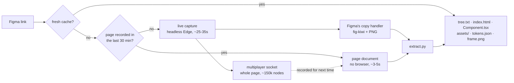

<div align="center">


# refigma-mcp

**Read Figma frames from an AI agent without the REST API, plugins, or a paid seat.**

An [MCP](https://modelcontextprotocol.io) server that turns a Figma link into a layout tree, pixel-faithful HTML / React + Tailwind,
SVG icons, design tokens and Figma's own PNG, then checks your implementation against that PNG pixel by pixel.

<p>
  <a href="https://github.com/haonguyenstech/refigma-mcp/releases/latest"></a>
  
  
  
  
  
  <a href="LICENSE"></a>
</p>

<a href="#features">Features</a> ·
<a href="#getting-started">Getting started</a> ·
<a href="#guide">Guide</a> ·
<a href="#tools">Tools</a> ·
<a href="#how-it-works">How it works</a> ·
<a href="#configuration">Configuration</a> ·
<a href="#limitations">Limitations</a>

<br /><br />


<sub>Example: “Send – fee” from the <a href="https://bitcoin.design">Bitcoin Design</a> UI Kit (CC BY 4.0).</sub>

</div>

---

## Features

### 🔓 Works on a View seat
| | Figma REST API | Figma plugin | **refigma-mcp** |
| --- | --- | --- | --- |
| View / Collab seat | ~20 reads / month | can't run | **no quota** |
| Needs | a token | an Edit seat | a figma.com login in Edge |
| Code out of the box | no | depends on the plugin | **HTML/CSS, React + Tailwind, SVG** |
| Verify an implementation | no | no | **pixel diff vs Figma's PNG** |

### 🌳 A layout tree an agent can read
Auto layout, sizes, fills with token names, strokes, radius, shadows, typography, text, style names, prototype interactions, hover variants and Dev Mode annotations, one line per layer. Instances are expanded the way Figma does it.

### 🧱 Code, icons and tokens
Deterministic HTML/CSS or a React component with Tailwind arbitrary values (incl. `:hover` from prototype variants), SVG icons named after their components, the original images, and every variable and style in use.

### 🎯 Checks your implementation
`figma_compare` renders your running app, an HTML file or the generated React in an sRGB headless Edge and diffs it with Figma's own PNG: match %, the worst regions and a diff image. Generated HTML scores **99.07–99.98%** on 12 production frames, see [Fidelity](#fidelity).

### ⚡ Fast after the first call
The first node of a page takes ~25–35s (mostly Figma loading the page). Every other node on that page then comes from the recorded document in ~3–5s, without a browser. See [Speed](#speed).

### 🛡️ Quiet and safe
A private headless Edge, no window, no Figma Desktop popping up; several agent sessions at once; design content treated as untrusted input. See [Reliability and safety](#reliability-and-safety).

---

## Getting started

### Requirements
- **macOS or Windows 10/11** with **Microsoft Edge**
- **Node ≥ 22.15**, **Python 3**, `curl` (built into both)
- On macOS: Edge signed in to figma.com, and Python's `cryptography` (to read that session)

### Install

```bash
claude mcp add -s user refigma-mcp -- npx -y https://github.com/haonguyenstech/refigma-mcp/releases/download/v0.5.0/refigma-mcp-0.5.0.tgz
```

The package is the `.tgz` attached to each [GitHub release](https://github.com/haonguyenstech/refigma-mcp/releases):
`npx` downloads it on first use and keeps it cached. Nothing to clone, no npm account. Any other MCP client takes
the same command:

```json
{ "mcpServers": { "refigma-mcp": { "command": "npx", "args": ["-y", "https://github.com/haonguyenstech/refigma-mcp/releases/download/v0.5.0/refigma-mcp-0.5.0.tgz"] } } }
```

For a global install instead: `npm install -g <the .tgz URL>`, then use `refigma-mcp` as the command.
Using Claude Desktop through [ccgw](https://github.com/haonguyenstech/ccgw)? `ccgw connector add refigma` writes the entry for you.

### Sign in to figma.com once

**macOS:** on the first capture the server copies your figma.com session from Edge. macOS shows a Keychain prompt
for **Microsoft Edge Safe Storage**: click **Allow**. If captures later report `NOT_LOGGED_IN`, run `figma_relogin`.

**Windows:** Edge's cookies there are app-bound encrypted and locked while Edge runs, so they cannot be copied.
The first capture reports `NOT_LOGGED_IN` and the agent calls `figma_relogin`, which opens an Edge window on
refigma's own profile at figma.com/login. Sign in there once (within 5 minutes); the profile keeps the session and
captures run headless from then on. Python from python.org or the Microsoft Store both work (`python` or `py -3`).

---

## Guide

### 1. Copy a link to a frame

In Figma, right-click a frame → **Copy link to selection**. The link carries the `node-id` of that frame.

### 2. Ask the agent

> Implement this design: https://www.figma.com/design/AbCdEf123/App?node-id=3685-53706

A typical agent run calls `figma_get_node` for the layout tree, `figma_get_assets` for icons and images,
`figma_get_code` as a starting point, and finally `figma_compare` against your dev server to check the result.

> 📌 Every answer states where the data came from (cache, recorded document or live capture) and how old it is. Pass `refresh: true` to capture again.

### 3. Or run it yourself with the CLI

`figma-read` writes the same outputs as the server:

```bash
npx -p https://github.com/haonguyenstech/refigma-mcp/releases/download/v0.5.0/refigma-mcp-0.5.0.tgz figma-read "<figma link>" [out dir]
```

<p align="center"></p>

One folder per node, default `~/.figma-local/out/<file>/<node>`:

<p align="center"></p>

| File | What |
| --- | --- |
| `tree.txt` | the layout tree, the same text `figma_get_node` returns |
| `index.html` | HTML/CSS that renders the frame |
| `<Component>.tsx` | React + Tailwind version of the same |
| `assets/icons/*.svg`, `assets/images/` | icons from vector geometry, original images |
| `tokens.json` | variables and styles in use |
| `frame.png` | Figma's own 1x PNG, the ground truth for `figma_compare` |
| `msg.json(.gz)`, `model.json` | the decoded copy data and normalized model, for re-generating |

The tree is what the agent reads first:

<p align="center"></p>

---

## Tools

Every tool takes a `figma.com/design/…` link; branch links (`…/branch/<key>/…`) read the branch. `node_id` accepts
`3685:53706`, `3685-53706` and instance ids (`I123:45;67:89`) and overrides the link's `node-id`. `refresh: true`
captures again instead of using the cache. Every answer states where the data came from and how old it is.

### Read the design

| Tool | Returns |
| --- | --- |
| `figma_get_metadata(url, node_id?, depth?, max_lines?)` | The file's pages and a sparse XML outline (id, name, type, x, y, w, h) under the link's node. Records the node's page if it was not recorded yet. Truncated at 1000 lines. |
| `figma_search(url, query, limit?)` | Layers whose **name** matches (not text content), with their path, on the recorded pages. |
| `figma_get_node(url, node_id?, max_lines?)` | The layout tree: auto layout, sizes, fills with token names, strokes, radius, shadows, typography, text, style names, prototype interactions, hover variants, Dev Mode annotations. Start here. |
| `figma_get_nodes(url, node_ids[], max_lines_each?)` | Several trees at once; nodes on a recorded page come from the document in seconds; an invalid id fails alone. |
| `figma_get_tokens(url)` | Variables (CSS variable, rendered value, values per mode) and the named text / fill / effect styles in use. |

### Generate

| Tool | Returns |
| --- | --- |
| `figma_get_code(url, format=html\|react, path_only?)` | Deterministic HTML/CSS, or a React component with Tailwind arbitrary values, incl. `:hover` rules and transitions from prototype hover variants. |
| `figma_get_assets(url, dest?)` | SVG icons built from vector geometry (named after their components) and the original images. A relative `dest` is resolved against your working directory; replaced files are listed. |
| `figma_export(url, node_id?, format=png\|jpg\|pdf, scale?, dest?)` | Any node at 1x–4x: transparent PNG, JPG or vector PDF, rendered from the verified HTML. |

### Verify

| Tool | Returns |
| --- | --- |
| `figma_get_image(url)` | Figma's own 1x PNG of the node — the ground truth. Images over 7900px or 5MB come back as a path. |
| `figma_compare(url, target?, selector?, viewport?, local_storage?, settle_ms?)` | Renders `target` (a URL, an HTML file, or `react`; default: the generated HTML) in an sRGB headless Edge and diffs it with Figma's PNG: match %, the worst regions and a diff image. |

`figma_compare` against a running app:

```jsonc
{
  "url": "https://www.figma.com/design/AbCdEf123/App?node-id=3685-53706",
  "target": "http://localhost:5173/notifications",
  "selector": "[data-testid=notification-popover]", // diff just this element
  "viewport": "1440x1024",
  "local_storage": { "token": "<access token>" },  // for pages behind a login
  "settle_ms": 1500                                 // wait for client-side rendering
}
```

### Session

| Tool | Does |
| --- | --- |
| `figma_relogin()` | macOS: copies the figma.com session from your real Edge profile again (Keychain prompt) and checks it. Windows: opens an Edge window to sign in to figma.com once. |
| `figma_status()` | The headless browser, recorded documents, and cached captures with their age. |

---

## How it works



A private **headless** Edge (no window, no Figma Desktop, CDP on `:9334`) opens the link in its own tab and:

- blocks FigmaAgent (`127.0.0.1:44950`), so Figma Desktop never pops up, and closes the
  *"Need to use the desktop app or installed fonts?"* dialog that would steal focus from Copy-as-PNG;
- uses a normal Edge user agent (Figma's CDN rejects `HeadlessChrome`) and no automation flag;
- records the multiplayer WebSocket: a `fig-wire` schema frame plus `NODE_CHANGES` with the whole loaded page,
  including components, variables and vector blobs;
- triggers Figma's own copy handler (`execCommand('copy')` on `input.focus-target`) and Copy-as-PNG for the node.

The clipboard payload and the page document are decoded locally (`kiwi-schema`, zstd / deflate) and turned into a
normalized model, then into code.

---

## Fidelity

Generated HTML compared with Figma's PNG, on 12 frames of two production files:

| Frames | Before the pixel-bench fixes | Now |
| --- | ---: | ---: |
| Modal with variant-driven icons | 58.8% | **99.83%** |
| Code / XML viewer | 65.0% | **99.40%** |
| Page with rotated scroll bars | 92.5% | **99.91%** |
| Notification popover | 97.1% | **99.07%** |
| The other 8 | 98.9–99.98% | **99.07–99.98%** |

React + Tailwind renders pixel-identical to the HTML on the frames checked. The remaining difference is mostly
text anti-aliasing and font metrics.

<details>
<summary><b>What makes it faithful</b></summary>

- **Instances are expanded the way Figma does it:** `guidPath` overrides at instance boundaries only; component
  properties (boolean / text / instance swap), with defaults from the component set; values read from `value` or, in
  newer files, `varValue` (incl. variable-bound booleans). Variant swaps reset to the new variant's styling.
- **Styles win over cached paints:** library shadow, image fill and text style references resolve to the style's
  current values, for every node, across several override entries of one node, and in text runs. Figma's copy
  handler skips them inside overrides, so this fixes clipboard output too.
- **Variables:** bound colours resolve through alias chains in the active mode (a paint's cached colour can be stale).
  Figma mirrors a bound colour's alpha into the paint opacity; it is applied once. A token painted in another mode
  inside the frame keeps its own colour.
- **Transforms:** rotations and flips use the full matrix; in auto layout the rotated bounding box takes the slot.
- **Strokes paint above children,** like Figma's: uniform strokes become `outline` with a negative offset (no layout
  impact), per-side strokes an `::after` border, gradient strokes a masked `::before`.
- **Layer order:** "first on top" stacks become z-index inside an isolated stacking context, so it stays local.
- **Shapes:** mask layers clip the layers above them; arcs (pie / donut); per-corner radii in SVG; SUBTRACT /
  INTERSECT through SVG masks; unique, stable SVG ids.
- **Text:** mixed runs, paragraph spacing, wrapping of over-long words, truncation with line clamp, text shadows.
- **Colour:** comparison renders with `--force-color-profile=srgb`; macOS Edge otherwise renders in Display P3 and
  every saturated colour is off.

</details>

---

## Speed

Measured on a 154k-node file with a View seat:

| Call | Time |
| --- | --- |
| Anything captured in the last 12h | instant (cache) |
| Node on a page recorded in the last 30 min, incl. `figma_get_nodes` batches | ~3-5s, no browser |
| First node of a page, or an older recording (live capture) | ~25-35s, mostly Figma: ~10s to send the page, ~11s to load it |
| `figma_get_metadata` / `figma_search` on a new page | ~12s |
| `figma_compare` | ~4s; ~15s for a 3442×1740 frame at 2x |

A recorded document is only used when every image of the node has a URL; otherwise the node is captured live.

---

## Reliability and safety

- **Several sessions at once:** captures are serialized across every refigma process on the machine
  (`~/.figma-local/capture.lock`); each capture works in a tab of its own and closes it; renders use a random port.
- **No stale code:** captures expire after 12h, and outputs record the extractor version — after an update of
  `lib/extract.py`, a cached capture is re-generated from its `msg.json.gz` in seconds instead of serving old code.
- **Nothing hangs:** every browser call has a timeout; a lost connection, a signal or an error ends the capture with
  a clear message and closes its tab; a killed render never leaves Edge running.
- **Design content is untrusted:** node ids are validated (they become paths) and links must be figma.com; layer names,
  links and font names are escaped in HTML, CSS and TSX; image downloads are pinned to Figma's hosts; the generated
  component is only transpiled in Node and rendered in the sandboxed browser.

---

## Updating

Each release has its own URL, so an install stays on its version until you switch it — nothing changes under you.

**Which version do I run?** The version is in the URL:

```bash
claude mcp get refigma-mcp      # Args: -y https://github.com/…/releases/download/v0.5.0/refigma-mcp-0.5.0.tgz
```

**Update** — take the URL of the [latest release](https://github.com/haonguyenstech/refigma-mcp/releases/latest)
(its release notes have the full command) and add the server again:

```bash
claude mcp remove refigma-mcp -s user
claude mcp add -s user refigma-mcp -- npx -y https://github.com/haonguyenstech/refigma-mcp/releases/download/vX.Y.Z/refigma-mcp-X.Y.Z.tgz
```

Then restart Claude Code, or run `/mcp` → `refigma-mcp` → **Reconnect** in an open session. Cached captures are
re-generated automatically when a release changes the extractor; to roll back, add the older release's URL.

---

## Configuration

| Variable | Default | Effect |
| --- | --- | --- |
| `REFIGMA_CACHE_MAX_AGE` | `43200` (12h) | Seconds a node capture is reused before it is taken again. |
| `REFIGMA_DOC_MAX_AGE` | `1800` | Seconds a recorded page document may serve node data. |
| `REFIGMA_SOURCE=clipboard` | — | Always capture live, never from a recorded document. |
| `REFIGMA_PROTO=1` | — | Experimental: try the prototype viewer first (just the frame, ~1MB; 10-25s; misses images the browser already cached). |
| `REFIGMA_LOAD_TIMEOUT` | `150` | Seconds a capture waits for the editor and the page document. |
| `REFIGMA_PORT` | `9334` | CDP port of the headless capture browser. |
| `REFIGMA_CDP` | — | Capture in another browser, e.g. `9222` to watch it in a visible debug Edge. |
| `REFIGMA_BROWSER` | Microsoft Edge | Browser executable for capture and rendering. |
| `REFIGMA_EDGE_PROFILE` | `~/Library/Application Support/Microsoft Edge/Default` | macOS: profile the figma.com session is copied from. |
| `REFIGMA_PYTHON` | `python3`; Windows: `python`, then `py -3` | Python 3 interpreter. |
| `REFIGMA_LOGIN_TIMEOUT` | `300` | Windows: seconds `figma_relogin` waits for the sign-in. |
| `FIGMA_API_KEY` / `FIGMA_ACCESS_TOKEN` | — | Fallback for images whose URL was never seen (REST image-fills, Tier 2 quota; cached per file for 12h). |
| `REFIGMA_TRACE=1` | — | Timing trace of a capture on stderr. |

**Cache** — `~/.figma-local/out/<file key>/`:

```text
<node id>/       tree.txt  index.html  <Component>.tsx  assets/  tokens.json  frame.png  msg.json.gz
_doc/<page id>/  recorded page document (schema + frames, outline, image URLs)
_images/         images shared by every node of the file
```

Deleting any of it is safe: it is captured again on the next call.

---

## Development

Run from a checkout instead of the published package:

```bash
git clone https://github.com/haonguyenstech/refigma-mcp && cd refigma-mcp && npm install
claude mcp add -s user refigma-mcp -- node "$PWD/server.mjs"
```

```text
server.mjs          MCP tools, cache, lock, source selection
lib/capture.mjs     drives the headless Edge: page document + copy data + PNG
lib/browser.mjs     the headless capture browser and its figma.com session (cookies.py decrypts Edge's cookies)
lib/doc.mjs         recorded page documents: ingest, outline, search, node extraction
lib/decode.mjs      Figma clipboard HTML → JSON message
lib/extract.py      message → model → tree.txt, HTML/CSS, React + Tailwind, SVG, tokens, images
lib/headless.mjs    throwaway sRGB render browser (compare, export)
lib/compare.mjs     render + pixel diff · lib/export.mjs  PNG / JPG / PDF · lib/render-tsx.mjs  React → page
```

**Check a change to `lib/extract.py` against every cached frame** — regenerating is cheap:

```bash
mkdir -p /tmp/out && python3 lib/extract.py <capture dir>/msg.json.gz <node id> /tmp/out > /tmp/out/extract.json
node lib/compare.mjs /tmp/out/index.html <capture dir>/frame.png <w> <h> /tmp/out/cmp   # w, h from extract.json
```

Run-to-run render noise is about ±0.001%. Accept a change only when no frame gets worse.

### Releasing

A release is a git tag plus the packed `.tgz` attached to its GitHub release — no npm account involved:

```bash
npm version 0.5.0 --no-git-tag-version          # bump package.json (the server reports this version)
git commit -am "v0.5.0" && git push
npm pack                                         # → refigma-mcp-0.5.0.tgz (15 files)
gh release create v0.5.0 refigma-mcp-0.5.0.tgz --title "v0.5.0" --notes "…"
```

Put the install command with the new URL in the release notes, then update the URLs in this README.

---

## Limitations

- Relies on Figma's undocumented clipboard and multiplayer formats; a Figma release can break it.
- Figma loads pages lazily: `figma_search` covers the pages recorded so far; `figma_get_metadata` records a node's
  page on demand.
- Not rendered yet: grid auto layout (children keep their absolute positions), angular / diamond gradients inside SVG
  icons, image fill opacity / crop / tile scale, corner smoothing (plain radius), vector masks in HTML (their box),
  boolean EXCLUDE (drawn like UNION). FigJam is started (`figjam_svg`) but not verified.
- Fonts missing from Google Fonts fall back to the browser's.
- A frame is static: no responsive behaviour; sizes are exact px, with hug / fill recorded in the tree.
- **Security:** the capture browser's CDP port (`:9334`) has no authentication and holds a signed-in figma.com
  session, so any local process can drive it.

---

## Credits

- [kiwi-schema](https://github.com/evanw/kiwi), [pixelmatch](https://github.com/mapbox/pixelmatch), [esbuild](https://esbuild.github.io), the [MCP TypeScript SDK](https://github.com/modelcontextprotocol/typescript-sdk)
- Example frame in the screenshots: [Bitcoin Design](https://bitcoin.design) UI Kit, CC BY 4.0

<div align="center"><sub>MIT License · Not affiliated with Figma.</sub></div>
